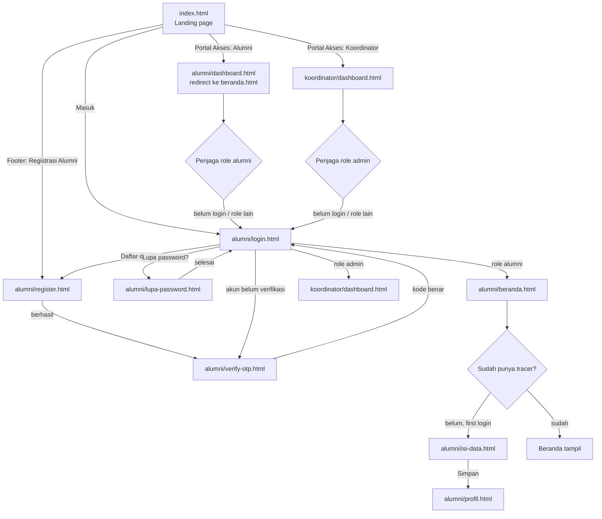
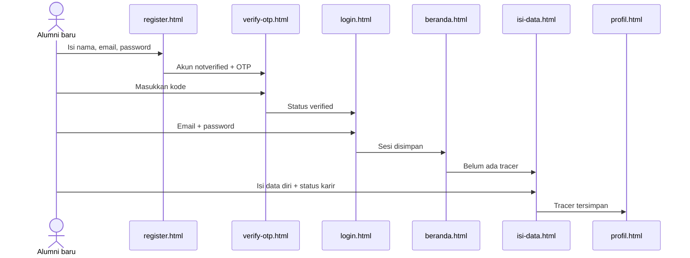
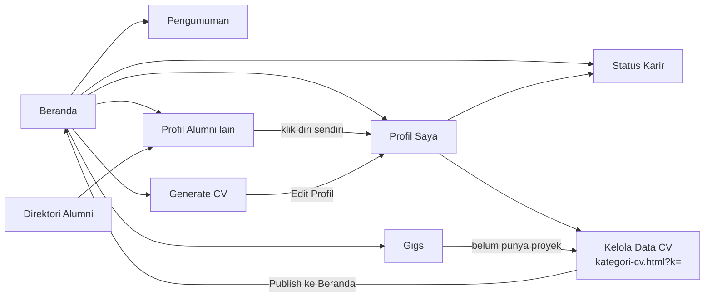
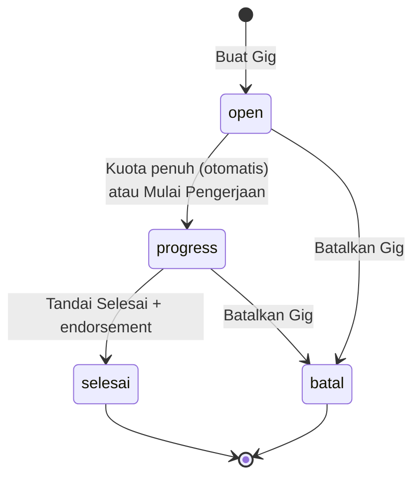
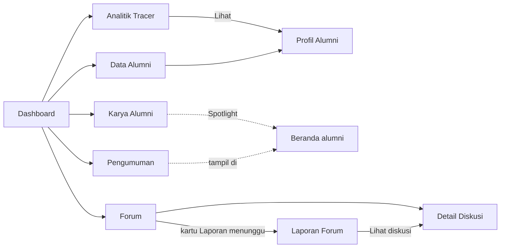

# Flow Alumni dan Koordinator

Dokumen ini memetakan alur prototype `alumni-bengkod-prototype` (branch `revisi-koordinator`, 2026-11-04) untuk role **Alumni** dan **Koordinator**, mulai dari landing page, register, login pertama, login berikutnya, sampai setiap menu. Semua isi dibaca langsung dari kode, bukan dari rencana.

Role Mitra dan SuperAdmin tidak dibahas. Tautan ke mitra sudah diputus. Tautan ke SuperAdmin masih ada di landing page (lihat bagian [Catatan untuk pencocokan](#9-catatan-untuk-pencocokan)).

---

## 1. Gambaran teknis singkat

| Hal | Isi |
|---|---|
| Penyimpanan | `localStorage` browser. Data di key `alumni_revisi_data_v5`, sesi login di key `alumni_revisi_sesi_v1` (berisi id user). |
| Sumber data dan aturan | `alumni/assets/js/data.js` (objek `DB`: `akun`, `tracer`, `statistik`, `cv`, `feed`, `gigs`, `forum`, `notifikasi`, `pengumuman`). |
| Penjaga role (middleware) | `alumni/assets/js/app.js`, dibaca dari atribut `<html data-role="alumni|admin">`. |
| Layout | Sidebar dan topbar dibuat otomatis oleh `app.js` untuk halaman yang punya `<main data-title>`. |
| Halaman login | Hanya satu: `alumni/login.html`, dipakai alumni dan koordinator. |
| Nama role di kode | Alumni = `alumni`, Koordinator = `admin`. |

### Akun contoh (tombol di halaman login)

| Akun | Email | Password | Kondisi |
|---|---|---|---|
| Alumni sudah isi data | `rizky@contoh.id` | `alumni123` | Sudah punya tracer, langsung masuk Beranda |
| Alumni first login | `nadia@contoh.id` | `alumni123` | Belum punya tracer, diarahkan ke Lengkapi Data |
| Koordinator | `koordinator@contoh.id` | `koor12345` | Langsung ke Dashboard Koordinator |

Tombol **Kembalikan data contoh ke awal** di halaman login menjalankan `DB.reset()`: seluruh data dibuat ulang dari contoh dan sesi login dihapus.

---

## 2. Peta alur besar

---

## 3. Register (ada)

Halaman: `alumni/register.html`. Bisa dibuka dari tombol **Daftar di sini** di login atau tautan **Registrasi Alumni** di footer landing. Register hanya untuk alumni. Akun koordinator tidak bisa didaftarkan, hanya ada dari data contoh.

### Langkah

1. Isi **Nama lengkap**, **Email**, **Password**.
2. Tekan **Daftar**. Validasi berurutan:

   | Cek | Pesan gagal |
   |---|---|
   | Format email (`nama@domain.tld`), dicek di halaman | Format email tidak valid. |
   | Nama kosong | Nama wajib diisi. |
   | Email sudah dipakai (tidak peka huruf besar/kecil) | Alamat email sudah terdaftar, silakan gunakan email lain. |
   | Password kurang dari 7 karakter | Password harus terdiri dari minimal 7 karakter. |

3. Kalau lolos, akun dibuat dengan `role: 'alumni'`, `status: 'notverified'`, dan kode OTP 6 digit acak.
4. Email disimpan di `sessionStorage.otp_email`, lalu pindah ke `verify-otp.html`.

NIM, tahun lulus, dan data lain **tidak** diminta saat register. Semuanya diisi saat first login.

### Verifikasi OTP

Halaman: `alumni/verify-otp.html`.

1. Halaman membaca `otp_email`. Kalau kosong atau email tidak ditemukan, langsung dialihkan ke `register.html`.
2. Karena prototype tidak mengirim email, kode OTP ditampilkan di kotak biru di halaman.
3. **Kirim ulang kode** membuat kode baru dan menampilkannya, toast "Kode baru sudah dikirim."
4. Tekan **Verifikasi**:
   - Kode salah atau kosong: "Kode OTP salah atau sudah kedaluwarsa."
   - Kode benar: status akun menjadi `verified`, kode dikosongkan, `otp_email` dihapus, toast "Verifikasi berhasil, silakan masuk.", lalu sekitar 0,9 detik kemudian pindah ke `login.html`.

Verifikasi **tidak** otomatis membuat user login. User harus masuk lagi dengan email dan password.

---

## 4. Login

Halaman: `alumni/login.html` (judul "Masuk").

### 4.1 Saat halaman dibuka

Kalau sesi masih ada di `localStorage`, halaman login langsung dialihkan:
- Alumni ke `beranda.html` (lalu bisa diteruskan ke `isi-data.html`, lihat 4.3).
- Koordinator ke `../koordinator/dashboard.html`.

Artinya tombol **Masuk** di landing tidak menampilkan form login selama user belum keluar.

### 4.2 Saat menekan Masuk

| Urutan cek | Hasil |
|---|---|
| Email kosong | "Email wajib diisi" di bawah kolom email |
| Password kosong | "Password wajib diisi" |
| Email tidak terdaftar | "Email belum terdaftar, silakan mendaftar terlebih dahulu." |
| Password salah | "Password yang dimasukkan salah." |
| Akun belum diverifikasi | Tidak ada pesan. `otp_email` disimpan, lalu pindah ke `verify-otp.html` |
| Semua benar | id user disimpan ke `alumni_revisi_sesi_v1`, lalu pindah ke dashboard sesuai role |

Fitur lain di halaman login: tombol mata untuk menampilkan password, tautan **Lupa password?**, tombol akun contoh, tombol reset data, dan **Kembali ke Halaman Utama**.

### 4.3 Login pertama alumni (first login)

"First login" di prototype ini berarti **alumni yang belum punya data tracer study**, bukan login yang pertama secara waktu.

1. Login berhasil, diarahkan ke `beranda.html`.
2. Penjaga role di `app.js` melihat alumni belum punya tracer, lalu `location.replace('isi-data.html')`.
3. Semua halaman alumni lain (Direktori, Gigs, Generate CV, Profil, dan seterusnya) juga dialihkan ke `isi-data.html` selama tracer belum diisi. Alumni tidak bisa melewati langkah ini.
4. Halaman **Lengkapi Data Anda** (`isi-data.html`):
   - Tanpa sidebar dan topbar, hanya logo dan tombol **Keluar**.
   - Sapaan: "Selamat datang, [nama]. Isi data ini sekali saja sebelum masuk ke portal..."
   - Form tracer (sama dengan form Status Karir, lihat 6.6).
5. Tekan **Simpan**. Kalau lolos validasi, langsung `location.replace('profil.html')`.
6. Kalau alumni yang sudah punya tracer membuka `isi-data.html`, halaman langsung dialihkan ke `profil.html`.

### 4.4 Login kedua dan seterusnya

**Alumni yang sudah punya tracer**
- Login, langsung ke **Beranda**. Tidak ada langkah tambahan.
- Kalau belum menekan Keluar, membuka portal lagi (bahkan setelah browser ditutup) langsung masuk, karena sesi ada di `localStorage`.

**Koordinator**
- Tidak punya langkah first login. Setiap login langsung ke **Dashboard Koordinator**.

### 4.5 Lupa password

Halaman: `alumni/lupa-password.html`. Berlaku untuk alumni dan koordinator. Empat langkah dalam satu halaman:

| Langkah | Isi | Gagal |
|---|---|---|
| 1. Email | Masukkan email, tekan **Kirim Kode**. Kode reset baru dibuat | "Email belum terdaftar." |
| 2. Kode | Kode contoh ditampilkan di kotak biru, tekan **Lanjutkan** | "Kode yang Anda masukkan salah." |
| 3. Password baru | Password baru dan ulangi, minimal 7 karakter | "Konfirmasi password tidak sama." atau "Password harus terdiri dari minimal 7 karakter." |
| 4. Selesai | "Password Berhasil Diubah", tombol **Masuk** ke `login.html` | - |

### 4.6 Penjaga role (pengalihan otomatis)

| Kondisi | Hasil |
|---|---|
| Belum login, membuka halaman alumni | ke `alumni/login.html` |
| Belum login, membuka halaman koordinator | ke `alumni/login.html` |
| Login sebagai koordinator, membuka halaman alumni | ke `login.html`, lalu login mengalihkan ke Dashboard Koordinator |
| Login sebagai alumni, membuka halaman koordinator | ke `alumni/login.html`, lalu login mengalihkan ke Beranda alumni |
| Alumni belum punya tracer, membuka halaman alumni mana pun | ke `isi-data.html` |
| Membuka `alumni/dashboard.html` atau `alumni/feed.html` (alamat lama) | redirect HTML ke `beranda.html` |

### 4.7 Keluar

Tombol **Keluar** ada di bagian bawah sidebar, di menu profil topbar, dan di halaman Lengkapi Data. Sesi dihapus, lalu kembali ke `index.html` (landing).

---

## 5. Layout bersama (alumni dan koordinator)

Setiap halaman yang punya `<main data-title>` mendapat:

- **Sidebar kiri** berisi menu sesuai role dan tombol Keluar. Di desktop (lebar 1024px ke atas) terbuka, di layar kecil tertutup dan dibuka lewat tombol garis tiga. Menu aktif berwarna biru. Halaman turunan menyalakan menu induknya lewat `data-nav`.
- **Topbar** berisi:
  - Breadcrumb `Alumni › [Judul Halaman]` atau `Koordinator › [Judul Halaman]`.
  - **Lonceng notifikasi** dengan jumlah belum dibaca, panel 15 notifikasi terakhir, tombol **Tandai semua dibaca**. Klik satu notifikasi menandainya dibaca dan membuka tautannya.
  - **Menu profil**: nama, keterangan (alumni: "Alumni Asisten Lab", koordinator: "Koordinator Alumni"), email, **Pengaturan Profil** (ke `profil.html`), **Keluar**.
- **Dialog konfirmasi** pengganti `confirm()` browser untuk aksi hapus atau batal.

Alumni tidak punya menu Forum, sehingga notifikasi yang tautannya diawali `forum` tidak ditampilkan untuk alumni.

---

## 6. Flow Alumni

### 6.1 Menu sidebar

| Menu | Halaman | Halaman turunan |
|---|---|---|
| Beranda | `beranda.html` | `pengumuman.html` |
| Alumni | `direktori.html` | `profil-alumni.html?id=` |
| Gigs & Proyek | `gigs.html` | - |
| Generate CV | `generate-cv.html` | - |
| Profil Saya | `profil.html` | `tracer.html`, `kategori-cv.html?k=` |

Tracer study tidak punya menu sendiri. Letaknya di Profil Saya (bagian Status Karir). Pengumuman juga tidak punya menu, tampil di kolom kanan Beranda.

### 6.2 Beranda (`beranda.html`)

Tata letak media sosial: feed di tengah, kolom info di kanan.

**a. Spotlight Bulan Ini** (paling atas, hanya muncul kalau ada)
- Karya Live yang disematkan koordinator, aktif 30 hari.
- Tiap karya: nama, tagline, pembuat, tech stack, tombol **Kunjungi Produk**, tombol suka.

**b. Kotak tulis (composer)**
- Teks maksimal 1000 karakter dengan penghitung, foto opsional (JPG/PNG/WEBP, maks 500 KB, bisa Ganti atau Hapus).
- Pilihan jenis: **Pengalaman** (bawaan) atau **Kegiatan**.
- Tombol **Posting** aktif kalau ada teks atau gambar. Setelah terbit: form direset, saringan kembali ke Semua, toast "Postingan berhasil dibagikan."
- Tombol tambahan: **Karya** (modal Pamerkan Karya) dan **Referral** (modal Bagikan Info Referral).

**c. Modal Pamerkan Karya**
- **Ambil dari Proyek dan Portofolio**: pilih proyek yang belum dipublikasikan, atau "Tulis dari nol". Memilih proyek mengisi nama, stack, tautan, dan deskripsi otomatis.
- Isian: Nama Produk*, Tautan Staging atau Live* (harus `http://` atau `https://`), Tagline*, Tahap (Beta butuh tester / Live sudah rilis), Fokus Review (Bug, UI/UX, Beban Server, Auth; wajib minimal satu kalau Beta, disembunyikan kalau Live), Deskripsi, Tangkapan Layar, Tech Stack, Tag Tim (pilih alumni lain).
- Karya yang ditulis dari nol otomatis ditambahkan ke Proyek dan Portofolio di Profil Saya.
- Proyek yang sudah dipublikasikan tidak bisa dipublikasikan dua kali.
- Toast "Karya berhasil dipublikasikan."

**d. Modal Bagikan Info Referral**
- Catatan: alumni hanya membuka jalan perkenalan, sistem tidak mencatat proses rekrutmen.
- Isian: Nama Perusahaan*, Role/Posisi*, Level Pengalaman* (Magang/Freshgrad, Junior 1-2 tahun, Mid), Batas Waktu Review* (tidak boleh sebelum hari ini), Pesan dan Kriteria Utama*.

**e. Saringan linimasa**: Semua, Pengalaman, Kegiatan, Hall of Fame (karya Live), Uji Coba Beta (karya Beta), #Referral.

**f. Kartu postingan**
- Foto dan nama penulis (klik ke profilnya), waktu, ringkasan karir dari tracer, label jenis, "Bersama [tim]" kalau ada tag.
- Postingan milik sendiri punya tombol **Hapus** (dengan konfirmasi). Menghapus karya tidak menghapus proyeknya di portofolio.
- Bar aksi:
  - Postingan biasa: **komentar** (buka panel, tulis, Kirim), **suka**, **Bagikan** (salin tautan `beranda.html#post-ID`).
  - Karya: **feedback** (buka panel feedback), **dukungan** (upvote), **Bagikan**.

**g. Alur Karya Beta dan Hall of Fame**

| Pelaku | Aksi | Akibat |
|---|---|---|
| Alumni lain | **Coba dan Uji** (buka tautan) lalu **Beri Feedback**: pilih kategori (Bug, UI/UX, Arsitektur/Performa, Apresiasi), tulis isi, centang upvote opsional | Pembuat dapat notifikasi |
| Pembuat | Tidak bisa memberi feedback ke karya sendiri | - |
| Pembuat | Tekan **Tandai diperbaiki/diterapkan** pada feedback (kecuali Apresiasi) | Bug jadi "Sudah diperbaiki", lainnya "Saran diterapkan", tester dapat notifikasi |
| Pembuat | Tekan **Promosikan ke Live**, konfirmasi | Tahap jadi Live, masuk Hall of Fame, fokus review dihapus |
| Koordinator | Sematkan karya Live ke Spotlight (dari menu Karya Alumni) | Karya tampil di Spotlight 30 hari, pembuat dapat notifikasi |

Lencana tester tampil di nama pemberi feedback, direktori, dan profil:
- **Active Tester**: minimal 3 feedback.
- **Quality Contributor**: minimal 2 feedback yang sudah ditanggapi pembuat.

**h. Alur Referral**

| Pelaku | Aksi | Akibat |
|---|---|---|
| Alumni lain | **Minta Review & Referral**: pilih versi CV (ATS Standar atau Modern Clean, ada tautan "Lihat CV saya"), tulis pesan perkenalan maks 250 karakter | Status "menunggu", pemilik referral dapat notifikasi |
| Alumni lain | Tidak bisa mengajukan dua kali, ke referral sendiri, atau setelah batas waktu lewat | Pesan gagal |
| Pemilik | **Lihat Pengajuan (n)** membuka drawer daftar pengajuan | - |
| Pemilik | **Preview CV**: di desktop tampil berdampingan (CV di kiri, drawer di kanan) | - |
| Pemilik | **WhatsApp** dengan pesan siap kirim | Status "dihubungi", pengaju dapat notifikasi |
| Pemilik | **Beri Masukan** satu baris, maks 150 karakter | Status "masukan", pengaju dapat notifikasi berisi masukan |
| Pemilik | Tombol LinkedIn kalau pengaju mengisi LinkedIn | - |

Status yang dilihat pengaju di kartu: "Pengajuan terkirim, menunggu respons", "Rekan alumni akan menghubungi Anda lewat WhatsApp / LinkedIn", atau kotak masukan. Kalau batas lewat: "Batas waktu review sudah lewat" dan label Ditutup.

**i. Kolom kanan**
- Kartu profil singkat: foto, nama, ringkasan karir, lalu pintasan Profil dan portofolio (jumlah data), Status karir (Perbarui), Generate CV, Lamaran gigs (jumlah aktif).
- **Pengumuman Terbaru** (3 terbaru, klik ke `pengumuman.html`).
- **Butuh Tester** (3 karya Beta terbaru, klik melompat ke kartunya).
- **Gigs Terbuka** (3 gig open, klik ke `gigs.html?id=`).

**j. Parameter URL**
- `beranda.html?karya=ID`: membuka modal Pamerkan Karya dengan proyek ID terisi (dari tombol "Publish ke Beranda" di portofolio).
- `beranda.html#post-ID`: menggulir ke postingan tersebut (dipakai notifikasi dan tombol Bagikan).

### 6.3 Pengumuman (`pengumuman.html`)

Hanya baca. Daftar semua pengumuman dari koordinator, terbaru di atas: judul, tanggal, "Oleh Koordinator Alumni", isi. Dibuka dari kartu Pengumuman Terbaru di Beranda.

### 6.4 Direktori Alumni (`direktori.html`, menu "Alumni")

- Saringan: kata kunci (nama, tempat kerja, keahlian, kota), angkatan (tahun masuk), keahlian (urut paling banyak dimiliki), kota, centang **Sedang S2**.
- Hanya alumni yang sudah punya tracer, diri sendiri tidak ikut. Urut nama A-Z, 12 per halaman.
- Kartu: foto, nama, ringkasan karir, angkatan dan kota, maks 4 keahlian, label Sedang S2 / Freelance / lencana tester, tombol **WhatsApp** (pesan salam kenal) dan **LinkedIn** (kalau kosong, membuka pencarian LinkedIn berdasarkan nama).
- Klik kartu ke `profil-alumni.html?id=`.

### 6.5 Profil Alumni lain (`profil-alumni.html?id=`)

- id tidak valid atau bukan alumni: kembali ke `direktori.html`. id diri sendiri: ke `profil.html`.
- Kepala: foto, nama, ringkasan karir, angkatan, tahun lulus, kota, keahlian, label, tombol WhatsApp, LinkedIn, Email.
- Kartu Data Diri dan Status Karir versi publik: **NIM dan nomor HP disembunyikan**.
- Semua kategori CV, tanpa tombol ubah.

### 6.6 Profil Saya (`profil.html`)

Urutan isi halaman:
1. **Kartu identitas**: foto (klik ikon kamera untuk unggah, JPG/PNG/WEBP maks 500 KB, langsung mengganti avatar di topbar), label role, nama, email.
2. **Status Karir** dan lencana tester, tombol **Ubah** ke `tracer.html`, lalu kartu Data Diri dan Status Karir lengkap (termasuk NIM dan HP).
3. **Riwayat, Portofolio, dan Kemampuan**: 8 kategori CV, tiap kategori punya ikon pensil ke `kategori-cv.html?k=`.
4. **Informasi Pribadi** (nama, email, password disamarkan) dan form **Ganti Password** (lama, baru minimal 7, konfirmasi). Pesan gagal: "Password lama tidak sesuai.", "Password baru minimal 7 karakter.", "Konfirmasi password tidak sama."

### 6.7 Status Karir / Tracer Study (`tracer.html`)

Mode ringkasan: judul, tanggal terakhir diperbarui, tombol **Edit Jawaban**, kartu Data Diri dan Status Karir.

Mode edit memakai form yang sama dengan Lengkapi Data, plus tombol **Batal**.

**Form tracer**

| Bagian | Isian | Kapan tampil |
|---|---|---|
| Data Diri | Nama dan Email (terkunci dari akun), Jenis Kelamin*, NIM*, Tahun Masuk*, Tahun Lulus*, Nomor HP WhatsApp* (8-15 angka), Kota Domisili*, Keahlian (dipisah koma) | Selalu |
| Status Saat Ini | Status* (7 pilihan), centang "Saya juga sedang menempuh studi lanjut (S2)", centang "Saya punya pekerjaan sampingan atau freelance" | Selalu. Centang S2 disembunyikan kalau status = Melanjutkan Pendidikan |
| Data Pekerjaan | Bidang (Infokom/Non Infokom)*, Kategori Pekerjaan*, Nama Instansi* (labelnya berubah: Tempat Bekerja / Tempat Part Time / Nama Usaha), Jabatan*, Tingkat Pekerjaan* | Status Bekerja Full Time, Bekerja Part Time, atau Wiraswasta |
| Data Studi Lanjut | Sumber Biaya*, Perguruan Tinggi*, Program Studi*, Tanggal Mulai* | Status Melanjutkan Pendidikan, atau centang S2 |
| Pekerjaan Sampingan | Tempat atau Klien*, Peran* | Centang sampingan |

Tujuh status: Bekerja Full Time, Bekerja Part Time, Wiraswasta, Melanjutkan Pendidikan, Tidak Bekerja Tetapi Sedang Mencari Pekerjaan, Belum Memungkinkan Bekerja, Menikah/Mengurus Keluarga.

Bagian yang tidak tampil dinonaktifkan, sehingga tidak divalidasi dan isinya dikosongkan saat disimpan.

Validasi di data: NIM wajib dan unik, nomor HP unik antar alumni, tahun lulus tidak boleh sebelum tahun masuk, kota wajib, status wajib dari daftar. Setelah simpan: toast "Data berhasil disimpan." dan kembali ke mode ringkasan. Data ini langsung dipakai Dashboard dan Analitik Tracer koordinator.

### 6.8 Kelola Data CV (`kategori-cv.html?k=`)

Kunci `k` yang valid: `academic`, `job`, `project`, `internship`, `organization`, `award`, `course`, `skill`. Kunci lain dialihkan ke `profil.html`.

| Kategori | Isian |
|---|---|
| Akademik | Universitas, Prodi, IPK (0-4), Tahun Masuk, Tahun Lulus, Kota, Negara, Catatan |
| Pekerjaan | Instansi, Jabatan, Mulai, Sampai, Kota, Negara, Catatan |
| Proyek dan Portofolio | Nama Proyek, Peran, Tahun, Tech Stack, Tautan (opsional), Deskripsi |
| Magang | Instansi, Jabatan, Mulai, Sampai, Kota, Negara, Catatan |
| Organisasi | Nama, Jabatan, Mulai, Sampai, Kota, Negara, Catatan |
| Penghargaan | Nama, Institusi, Tingkat (Lokal/Nasional/Internasional), Tahun, Deskripsi |
| Sertifikat dan Lisensi | Nama Pelatihan, Institusi, Tingkat, Tahun |
| Kemampuan Diri | 7 penilaian skala Sangat Baik/Baik/Cukup/Kurang. **Hanya satu baris**, tombol Tambah hilang setelah terisi |

Aksi: **Tambah Data**, **Edit** (ikon pensil), **Hapus** (dengan konfirmasi). Semua isian wajib kecuali tautan proyek, divalidasi oleh browser.

Khusus Proyek dan Portofolio:
- Proyek yang belum dipublikasikan punya tombol **Publish ke Beranda** (ke `beranda.html?karya=ID`).
- Proyek yang sudah dipublikasikan menampilkan tautan ke postingannya.
- Proyek hasil gig selesai diberi label Gigs.

### 6.9 Generate CV (`generate-cv.html`)

- CV dibuat otomatis dari data Profil Saya.
- Pilih format **ATS Standar** atau **Modern Clean**.
- Centang bagian yang ditampilkan (8 kategori). Centang **Pengalaman Freelance** hanya muncul kalau ada proyek dari gig yang selesai.
- Tombol **Edit Profil** (ke `profil.html`) dan **Cetak / Unduh PDF** (`window.print()`).

### 6.10 Gigs & Proyek (`gigs.html`)

Tiga tab: **Papan Gigs**, **Proyek Saya**, **Lamaran Saya** (masing-masing dengan jumlah).

Saringan di Papan Gigs: kata kunci, peran (Frontend, Backend, Mobile, UI/UX, QA), tech stack, budget, status (bawaan Buka Lamaran).

**Siklus status gig**

**Sebagai pemilik proyek**
1. **Buat Gig**: Judul* (minimal 10 karakter), Peran* (minimal satu), Tech Stack*, Deskripsi dan Deliverables*, Budget* (5 rentang termasuk Bagi Hasil/Equity), Deadline* (tidak boleh lewat), Kuota Tim* (1-10). Setelah terbit pindah ke tab Proyek Saya.
2. **Kelola Pelamar** (drawer): tiap pelamar menampilkan angkatan, karir, keahlian, pitching, proyek lampiran. Tombol **Terima** atau **Tolak**. Pelamar diterima mendapat tombol WhatsApp.
3. Saat jumlah diterima = kuota, gig otomatis jadi **Sedang Dikerjakan** dan pelamar yang masih menunggu otomatis ditolak (dengan notifikasi). Bisa juga **Mulai Pengerjaan** lebih awal kalau sudah ada minimal satu yang diterima.
4. **Tandai Selesai**: tulis endorsement, centang opsional "Bagikan ke Beranda". Proyek otomatis masuk portofolio setiap kontributor (label Gigs), kontributor dapat notifikasi, dan kalau dicentang muncul postingan di Beranda yang men-tag tim.
5. **Batalkan Gig** (konfirmasi): pelamar dan kontributor diberi tahu, gig tidak bisa dibuka lagi.

**Sebagai pelamar**
1. **Lihat Detail** membuka modal detail gig.
2. Kalau belum punya proyek di portofolio, muncul ajakan menambah proyek dulu (ke `kategori-cv.html?k=project`).
3. **Ajukan Minat**: pitching maks 250 karakter dan lampiran 1-2 proyek dari portofolio sendiri. Tidak bisa melamar gig sendiri atau dua kali.
4. Status lamaran: Menunggu review, Belum diterima, Diterima, Sedang Dikerjakan, Selesai, Gig dibatalkan. Setelah diterima, tombol WhatsApp ke pemilik terbuka.

`gigs.html?id=ID` (dari notifikasi): pemilik langsung dibukakan drawer Kelola Pelamar, orang lain dibukakan detail gig.

### 6.11 Notifikasi yang diterima alumni

| Pemicu | Isi singkat | Tautan |
|---|---|---|
| Alumni lain memberi feedback ke karya | "[nama] memberi feedback [kategori] untuk [karya]." | Beranda, postingan |
| Pembuat menanggapi feedback | "Feedback ... sudah diperbaiki/diterapkan." | Beranda, postingan |
| Koordinator memasang Spotlight | "[karya] masuk Spotlight Beranda selama 30 hari." | Beranda, postingan |
| Ada pengajuan ke referral | "[nama] meminta review dan referral untuk [posisi]." | Beranda, postingan |
| Pemilik referral menekan WhatsApp | "... akan menghubungi Anda lewat WhatsApp ..." | Beranda, postingan |
| Pemilik referral memberi masukan | "Masukan dari ...: ..." | Beranda, postingan |
| Ada pelamar gig | "[nama] mengajukan minat di [gig]." | `gigs.html?id=` |
| Lamaran diterima / ditolak / tim penuh / gig batal | sesuai kejadian | `gigs.html?id=` |
| Gig selesai | "... memberi endorsement. Proyeknya sudah masuk portofolio Anda." | `profil.html` |

---

## 7. Flow Koordinator

### 7.1 Menu sidebar

| Menu | Halaman | Halaman turunan |
|---|---|---|
| Dashboard | `dashboard.html` | - |
| Statistik Data Alumni | `statistik.html` | - |
| Analitik Tracer | `tracer.html` | `profil-alumni.html?id=` (tombol Lihat) |
| Data Alumni | `data-alumni.html` | `profil-alumni.html?id=` |
| Karya Alumni | `karya.html` | - |
| Pengumuman | `pengumuman.html` | - |
| Forum | `forum.html` | `forum-detail.html?id=` |
| Laporan Forum | `laporan-forum.html` | - |

Profil Koordinator (`profil.html`) dibuka dari menu profil topbar, tidak ada di sidebar.

### 7.2 Dashboard (`dashboard.html`)

1. **Banner sapaan**: tanggal hari ini, "Halo, [nama]!".
2. **Lima kartu pintasan**: Analitik Tracer (jumlah jawaban), Data Alumni (jumlah akun alumni terverifikasi), Karya Alumni (jumlah spotlight dan karya), Pengumuman (jumlah terbit), Forum (jumlah diskusi dan laporan menunggu).
3. **Statistik Alumni**: jumlah alumni 3 tahun terakhir, alumni terdeteksi 3 tahun terakhir, jumlah alumni semua tahun.
4. **Grafik donat Tracer Study** per 7 status, dengan legenda angka.
5. **Kalender** bulan berjalan, hari ini ditandai.
6. **Alumni Terdeteksi Tiga Tahun Terakhir**: grafik batang (Total, Terdeteksi, Tidak Terdeteksi) dan tabel. Terdeteksi berarti sudah mengisi tracer.
7. **Pekerjaan Alumni**: donat Bekerja vs Tidak Bekerja (yang melanjutkan pendidikan tidak dihitung), donat Bidang Pekerjaan, donat Lingkup Pekerjaan.

Halaman ini hanya baca.

### 7.3 Statistik Data Alumni (`statistik.html`)

- Tabel per tahun lulus: Total Alumni (diisi koordinator), Alumni Terdeteksi (otomatis dari tracer), Cakupan (persen dan batang).
- Tahun yang muncul dari tracer tapi belum dicatat koordinator tetap tampil dengan total 0, tombol hapusnya nonaktif.
- **Tambah Data**: Tahun Lulus* (mulai 1990), Total Alumni* (0 ke atas). Tahun yang sudah ada ditolak: "Data tahun [x] sudah ada. Gunakan tombol edit."
- **Edit** dan **Hapus** (dengan konfirmasi).
- Alat tabel: **Salin**, **Ekspor ke Excel** (`statistik-alumni.csv`), **Cetak**.

### 7.4 Analitik Tracer (`tracer.html`)

- Grafik donat per status dan legendanya.
- Kartu 7 status (kategori Melanjutkan Pendidikan dan Sedang Studi Lanjut S2 disatukan) plus 1 kartu profil (Punya pekerjaan sampingan). Klik kartu mengisi filter dan menggulir ke tabel.
- Filter: cari (nama, NIM, tempat, kota), status, profil, tahun lulus.
- Tabel 10 per halaman: Alumni (foto, nama, NIM), Lulus, Kontak (WhatsApp, email, LinkedIn), Status, Tempat (plus baris S2 dan sampingan), Posisi, tombol **Lihat** ke profil.
- Alat: **Salin**, **Ekspor ke Excel** (`analitik-tracer.csv`, 22 kolom kuesioner lengkap, mengikuti filter), **Cetak**.

### 7.5 Data Alumni (`data-alumni.html`) dan Profil Alumni (`profil-alumni.html?id=`)

**Data Alumni**
- Semua akun alumni yang sudah verifikasi email, termasuk yang belum mengisi tracer (keterangan "Belum mengisi data").
- Cari nama, email, atau tempat. 12 per halaman. Klik kartu ke profil.
- Tidak ada fitur tambah, ubah, atau hapus akun alumni.

**Profil Alumni (versi koordinator)**
- id tidak valid atau bukan alumni: kembali ke `data-alumni.html`.
- Kepala: foto, nama, email, **NIM**, tahun lulus, tautan **WhatsApp + nomor HP**, LinkedIn, label status (atau "Belum mengisi data").
- Kartu Data Diri dan Status Karir **lengkap** (NIM dan HP tampil, berbeda dengan versi sesama alumni).
- Semua kategori CV, hanya baca.

### 7.6 Karya Alumni (`karya.html`)

- Judul halaman: Hall of Fame dan Beta Testing.
- Tab **Live Product** dan **Beta Testing**.
- Tabel: Karya (nama, tagline, tautan aplikasi), Pembuat, Dukungan, Feedback (masuk dan ditanggapi; Beta juga menampilkan fokus review), Spotlight (Aktif sampai tanggal), Aksi.
- Urutan: yang sedang Spotlight di atas, lalu dukungan terbanyak.
- Di tab Live: tombol **Sematkan** / **Lepas** Spotlight. Sematkan berlaku 30 hari dan memberi notifikasi ke pembuat. Karya Beta tidak bisa di-spotlight.

### 7.7 Pengumuman (`pengumuman.html`)

- Tabel 5 per halaman: No, Judul, Isi, Tanggal, Aksi. Cari judul atau isi.
- **Tambah Pengumuman**: Judul* (maks 255), Isi*. Langsung terbit dengan tanggal hari ini dan penulis "Koordinator Alumni".
- **Edit** (judul dan isi, tanggal tetap) dan **Hapus** (konfirmasi, permanen).
- Alat: Salin, Ekspor ke Excel (`pengumuman.csv`), Cetak.
- Hasilnya tampil di Beranda alumni (3 terbaru) dan halaman Pengumuman alumni.
- Membuat pengumuman **tidak** mengirim notifikasi ke alumni.

### 7.8 Forum (`forum.html`) dan Detail Diskusi (`forum-detail.html?id=`)

**Daftar diskusi**
- Ringkasan khusus koordinator: Total diskusi, Belum terjawab, Alumni aktif 30 hari, Laporan menunggu (klik ke Laporan Forum).
- Cari (judul, isi, balasan, nama penulis), saringan kategori (Karier, Teknologi, Studi Lanjut, Wirausaha, Kampus dan Komunitas), tab **Terbaru** (yang disematkan di atas), **Populer**, **Belum Terjawab**, **Tersimpan**, **Diskusi Saya**, **#Referral** dan **Disembunyikan** (khusus koordinator). Tab #Referral menampilkan info referral yang dibagikan alumni di Beranda (posisi, perusahaan, level, batas review, status Dibuka atau Ditutup, jumlah pengajuan per status). Isinya hanya untuk dipantau. Saringan kategori disembunyikan di tab ini. Filter `?tag=` dari klik #tag.
- Kolom samping: Belum Terjawab, Sedang Ramai, Alumni Paling Membantu (poin = jawaban terbaik x5 + suka), Tag Populer.
- **Buat Diskusi**: Jenis (Pertanyaan, Diskusi, Polling), Kategori, Judul (minimal 10 karakter, muncul saran "Mungkin sudah pernah dibahas"), Isi (bisa #tag), Pilihan Polling (minimal 2, tidak bisa diubah setelah terbit), Gambar opsional.

**Detail diskusi**
- Menambah jumlah dilihat setiap dibuka.
- Aksi umum: suka, simpan (bookmark), salin tautan, edit dan hapus (kalau penulisnya).
- Moderasi koordinator: **Sematkan / Lepas Sematan**, **Tutup Diskusi / Buka Kembali** (diskusi tertutup tidak bisa dibalas dan polling terkunci), **Sembunyikan / Pulihkan** (dengan alasan; konten tidak dihapus).
- Balasan satu tingkat: Balas, suka, Edit dan Hapus milik sendiri (menghapus balasan ikut menghapus anak balasannya), **Pilih jawaban terbaik** (penanya atau koordinator, hanya untuk jenis Pertanyaan), Sembunyikan / Pulihkan per balasan.
- Polling: koordinator tidak bisa memberi suara.
- Kolom samping: daftar alumni yang cocok membantu (dicocokkan dari data tracer sesuai kategori) dengan tombol **Undang** untuk pertanyaan yang belum terjawab, dan diskusi terkait.
- Tombol **Laporkan** tidak tampil untuk koordinator.

### 7.9 Laporan Forum (`laporan-forum.html`)

- Tab **Menunggu**, **Selesai**, **Diabaikan** (dengan jumlah). Cari konten, penulis, atau pelapor. 8 per halaman.
- Tabel: Konten (label Diskusi/Balasan, penulis, cuplikan, tautan ke diskusi), Alasan (Spam, Pelecehan, Tidak Relevan, Lainnya + catatan), Pelapor, Tanggal, Aksi.

| Aksi | Akibat |
|---|---|
| **Abaikan** | Laporan jadi Diabaikan, konten tetap tampil, pelapor diberi tahu "tidak ditemukan pelanggaran" |
| **Sembunyikan** (konfirmasi) | Konten disembunyikan dengan alasan laporan, semua laporan atas konten yang sama ikut Selesai, penulis dan pelapor diberi tahu. Kalau yang disembunyikan adalah jawaban terbaik, tanda jawaban dilepas |
| **Pulihkan** (di tab Selesai) | Konten tampil lagi, penulis diberi tahu |

### 7.10 Profil Koordinator (`profil.html`)

Sama dengan bagian umum Profil Saya alumni tanpa tracer dan CV: unggah foto, informasi pribadi (nama, email), Ganti Password.

### 7.11 Notifikasi yang diterima koordinator

| Pemicu | Tautan |
|---|---|
| Ada laporan forum baru | `laporan-forum.html` |
| Balasan di diskusi milik koordinator, atau balasan ke balasannya | `forum-detail.html?id=#balasan-` |

---

## 8. Keterkaitan data antar role

| Data | Diisi oleh | Dipakai di |
|---|---|---|
| Akun (nama, email, password, foto) | Alumni saat register; koordinator dari data contoh | Semua halaman |
| Tracer study | Alumni (Lengkapi Data, Status Karir) | Dashboard, Statistik (terdeteksi), Analitik Tracer, Data Alumni, Profil Alumni, Direktori, ringkasan karir di Beranda dan Gigs, saran "bisa bantu" di Forum |
| Total lulusan per tahun | Koordinator (Statistik) | Dashboard, Statistik |
| Data CV 8 kategori | Alumni (Kelola Data) | Profil Saya, Profil Alumni (kedua role), Generate CV, preview CV referral, lampiran Gigs, sumber Karya |
| Postingan, karya, referral | Alumni (Beranda) | Beranda; karya juga di Karya Alumni koordinator |
| Spotlight | Koordinator (Karya Alumni) | Spotlight di Beranda alumni |
| Pengumuman | Koordinator | Beranda dan Pengumuman alumni |
| Gigs | Alumni | Gigs, kolom kanan Beranda, portofolio kontributor |
| Forum dan laporan | Koordinator (dan data contoh) | Forum dan Laporan Forum koordinator |

---

## 9. Catatan untuk pencocokan

Hal-hal yang perlu diperhatikan saat membandingkan dengan folder referensi:

1. **Alumni tidak punya menu Forum.** File forum hanya ada di folder `koordinator/`. Akibatnya, di prototype ini alumni tidak bisa membuat diskusi, membalas, melapor, atau memberi suara polling. Isi forum yang dimoderasi koordinator hanya berasal dari data contoh dan dari koordinator sendiri, dan Laporan Forum tidak akan menerima laporan baru dari alumni. Komentar di `forum.js` masih menyebut "sama untuk alumni dan koordinator".
2. **Notifikasi forum untuk alumni tetap dibuat tapi tidak ditampilkan.** Contoh: saat koordinator menyembunyikan diskusi milik alumni, notifikasinya tersimpan, tapi disaring dari lonceng alumni.
3. **First login ditentukan oleh ada tidaknya tracer**, bukan oleh penanda "pertama kali login". Pengecekannya ada di `app.js` dan berjalan di setiap halaman alumni.
4. **Setelah verifikasi OTP, user harus login manual.** Tidak ada login otomatis.
5. **Halaman login langsung melewati form kalau sesi masih ada.** Sesi disimpan di `localStorage` sehingga tetap ada setelah browser ditutup.
6. **Halaman register tidak mengecek sesi.** User yang sedang login masih bisa membuka dan mengisi register.
7. **Lupa password memakai kolom kode yang sama dengan OTP registrasi.** Kalau akun yang belum verifikasi melakukan reset password, kodenya dikosongkan setelah reset, sehingga saat login dan diarahkan ke Verifikasi Email, kode contoh kosong dan user perlu menekan "Kirim ulang kode".
8. **Data Alumni koordinator tidak punya fitur tambah akun.** Akun alumni hanya bisa dibuat lewat register.
9. **Alumni yang belum verifikasi email tidak terlihat** di Data Alumni, Direktori, maupun jumlah akun di Dashboard.
10. **Pengumuman baru tidak mengirim notifikasi** ke alumni.
11. **Koordinator tidak punya halaman untuk melihat Beranda alumni.** Karya dipantau dari tabel Karya Alumni, dan tautannya membuka aplikasi karya, bukan postingannya.
12. **Landing page masih menautkan SuperAdmin** (Portal Akses, footer, dan daftar portal di bawah). Tautan Portal Akses Alumni masih menuju alamat lama `alumni/dashboard.html`, yang lalu dialihkan ke Beranda.
13. **Statistik "terdeteksi" dihitung dari tahun lulus di tracer.** Tahun lulus yang ada di tracer tapi belum dicatat koordinator tetap tampil dengan total 0.
