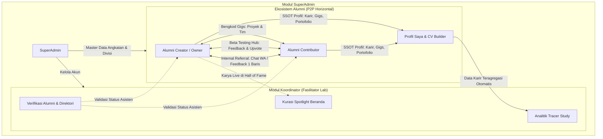
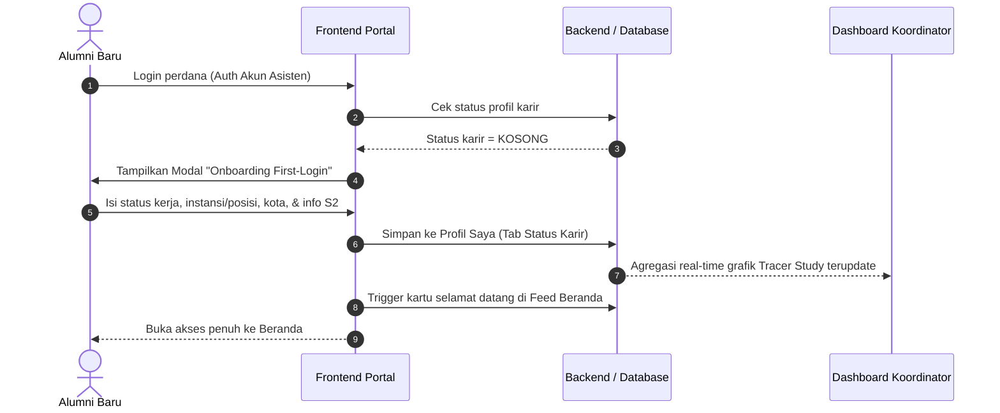
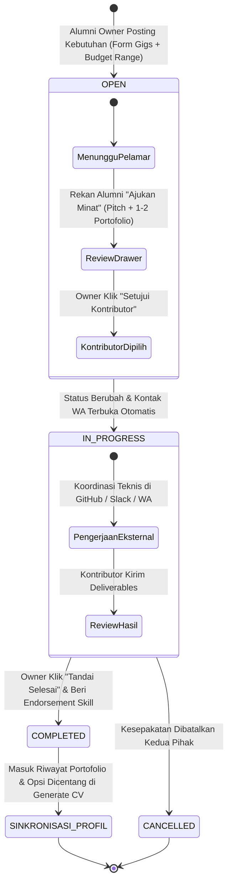
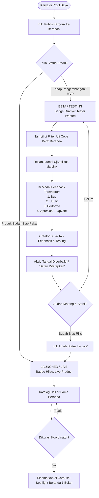
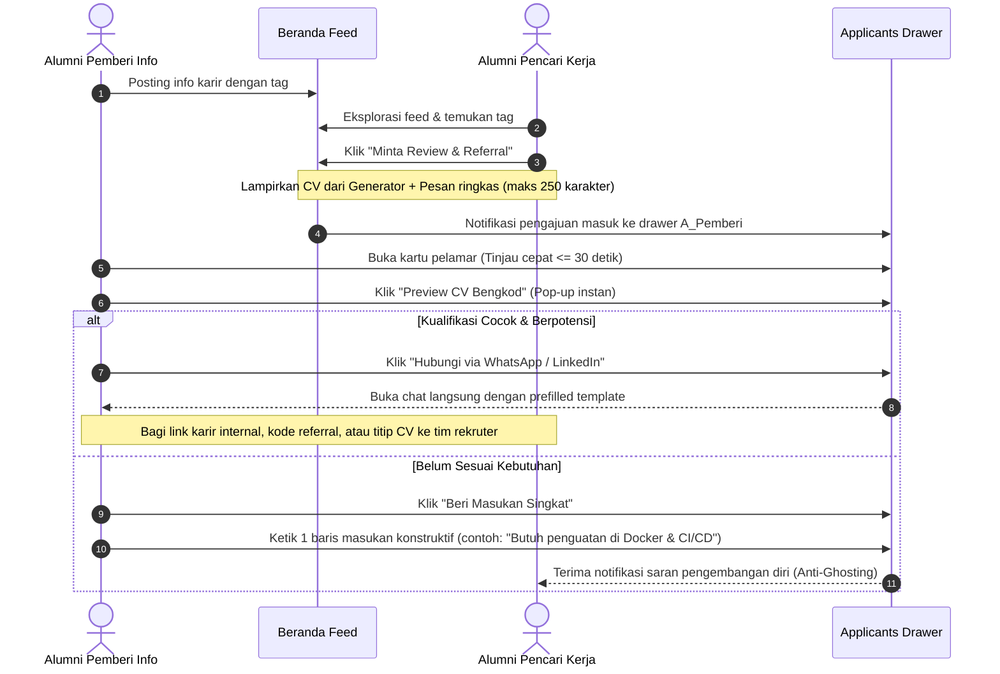
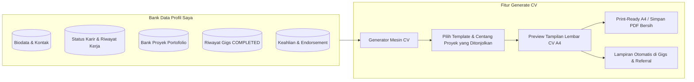
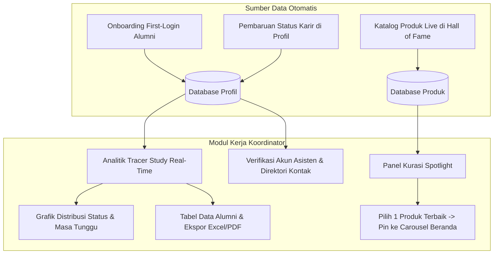

# Spesifikasi Arsitektur & Inventaris Fitur Portal Alumni Bengkel Koding
**Versi:** 2.1 (Brainstorming & Reposisi Sistem)  
**Status:** Draf Perencanaan  
**Prinsip Utama:** Peer-to-Peer (P2P) Horizontal, 100% Eksklusif Sesama Alumni Asisten Lab Bengkel Koding (Tanpa Mitra, Tanpa Hierarki Senior/Junior, Tanpa Mahasiswa Aktif).

---

## 1. Ringkasan Eksekutif & Reposisi Paradigma

Portal Alumni Bengkel Koding direposisi dari bursa kerja (*job board*) konvensional menjadi **ekosistem kolaborasi teknologi, pertukaran proyek freelance, pengujian produk, dan pelacakan karir terintegrasi (*tracer study*)**.

### Prinsip Fondasi:
1. **P2P Setara (Horizontal):** Seluruh interaksi terjadi murni antar-rekan alumni purna tugas asisten lab. Tidak ada hierarki senior vs junior, dan tidak melibatkan adik tingkat / mahasiswa aktif.
2. **Eliminasi Peran Mitra 100%:** Seluruh modul, pendaftaran akun, dan alur perusahaan/mitra dihapus total.
3. **Embedded Tracer Study:** Menu survei kaku di sidebar ditiadakan; data tracer dikumpulkan secara progresif melalui *first-login onboarding* dan tersimpan di `Profil Saya`.
4. **Bebas Beban Finansial & Legal:** Sistem tidak memproses transaksi uang, escrow, rekening, maupun bukti transfer (menggunakan model *Transparent Range*).

---

## 2. Inventaris Fitur Berdasarkan Role

### A. Role: Alumni (Aktor Utama Komunitas)

| No | Modul | Fitur | Deskripsi Fungsional |
| :--- | :--- | :--- | :--- |
| 1 | **Onboarding** | Wizard First-Login | Modal pengisian status karir perdana (pekerjaan utama, freelance, studi S2, domisili) saat pertama kali masuk. |
| 2 | **Beranda** | Linimasa Interaktif (Feed) | Feed aktivitas komunitas: posting diskusi teknis, pembaruan karir, dan pengumuman. |
| 3 | **Beranda** | Carousel Spotlight | Menampilkan produk alumni terbaik hasil kurasi bulanan Koordinator. |
| 4 | **Beranda** | Widget Gigs & Beta Test | Menampilkan proyek gigs yang masih `OPEN` dan produk yang membutuhkan tester. |
| 5 | **Alumni** | Direktori Rekan Alumni | Pencarian katalog seluruh alumni asisten lab dengan filter angkatan, keahlian, kota, dan status S2. |
| 6 | **Alumni** | Direct Connect | Tombol pintas menghubungi rekan alumni via WhatsApp / LinkedIn. |
| 7 | **Gigs** | Posting Kebutuhan (Create Gig) | Formulir membuat lowongan kolaborasi side-project dengan model budget *Transparent Range*. |
| 8 | **Gigs** | Applicants Drawer & Review | Drawer peninjauan pelamar: pesan pitching ($\le$ 250 karakter) dan 1-2 portofolio terlampir. |
| 9 | **Gigs** | Assign Contributor | Pemilihan kontributor; mengubah status ke `IN PROGRESS` dan membuka kontak chat pengerjaan. |
| 10 | **Gigs** | Selesai & Endorsement | Menandai pengerjaan selesai (`COMPLETED`) dan memberikan catatan endorsement skill ke profil kontributor. |
| 11 | **Gigs** | Quick Apply Gigs | Mengajukan minat pengerjaan proyek rekan alumni dengan melampirkan portofolio langsung dari profil. |
| 12 | **Showcase** | Publish Produk ke Beranda | Menerbitkan karya dari bank portofolio profil ke etalase publik (pilihan tahap: Beta vs Live). |
| 13 | **Showcase** | Beta Testing Feedback Hub | Wadah pengujian MVP: modal feedback 4 kategori terstruktur (Bug, UI/UX, Performa, Apresiasi) + Upvote. |
| 14 | **Showcase** | Manajemen Feedback Creator | Dasbor pemilik produk untuk merespons saran: tombol "Tandai Diperbaiki" atau "Saran Diterapkan". |
| 15 | **Showcase** | Reputasi Tester | Pemberian lencana profil otomatis (`Active Tester`) bagi alumni yang aktif menguji produk rekan. |
| 16 | **Referral** | Posting Peluang (#Referral) | Membagikan informasi lowongan di kantor masing-masing dengan tagar `#Referral` dan kriteria ringkas. |
| 17 | **Referral** | Minta Review & Referral | Mengajukan permohonan referral dengan pesan singkat ($\le$ 250 karakter) dan lampiran CV instan. |
| 18 | **Referral** | Fast Review Drawer ($\le$ 30 dtk) | Peninjau melihat CV pop-up instan dan memilih: "Hubungi via WA/LinkedIn" ATAU "Beri Masukan 1 Baris". |
| 19 | **Generate CV** | Generator CV Otomatis | Menghasilkan CV profesional format A4 print-ready langsung dari data profil, portofolio, dan riwayat gigs. |
| 20 | **Generate CV** | Preview & Cetak PDF | Pratinjau langsung tanpa unduh rumit, terintegrasi sebagai lampiran cepat pada Gigs & Referral. |
| 21 | **Profil Saya** | Single Source of Truth (SSOT) | Kelola biodata lengkap, kontak, sosial media, dan keahlian teknis. |
| 22 | **Profil Saya** | Tab Status Karir (Tracer) | Pengkinian status pekerjaan utama, freelance/moonlighting, dan rincian studi lanjut S2. |
| 23 | **Profil Saya** | Bank Karya & Portofolio | Penyimpanan repositori proyek pribadi, capstone, dan riwayat pengerjaan Gigs yang selesai. |

---

### B. Role: Koordinator (Admin Lab / Fasilitator)

| No | Modul | Fitur | Deskripsi Fungsional |
| :--- | :--- | :--- | :--- |
| 1 | **Dashboard** | Metrik Komunitas | Statistik total alumni terdaftar, persentase pengisian tracer, rasio angkatan, dan keahlian populer. |
| 2 | **Tracer** | Analitik Karir Real-Time | Grafik distribusi status karir (Bekerja, Wirausaha, Freelance, S2, Mencari Kerja) yang teragregasi otomatis. |
| 3 | **Tracer** | Matriks Masa Tunggu & Gaji | Visualisasi masa tunggu alumni memperoleh pekerjaan pertama dan sebaran bidang industri. |
| 4 | **Tracer** | Tabel Ekspor Data | Tabel data tracer lengkap dengan filter dinamis, fitur cetak, dan ekspor ke format Excel/CSV/PDF. |
| 5 | **Kurasi** | Kurasi Spotlight Produk | Fitur menyematkan (*pin*) produk live terbaik dari Hall of Fame ke carousel teratas Beranda selama 1 bulan. |
| 6 | **Data Alumni** | Verifikasi & Direktori | Verifikasi status keabsahan purna-tugas asisten lab dan pembaruan buku kontak alumni aktif. |
| 7 | **Pengumuman** | Broadcast Pengumuman | Menerbitkan info resmi lab/kampus ke linimasa Beranda seluruh alumni. |

---

### C. Role: SuperAdmin (Administrator Sistem)

| No | Modul | Fitur | Deskripsi Fungsional |
| :--- | :--- | :--- | :--- |
| 1 | **Pengguna** | Manajemen Akun Koordinator | Pembuatan akun koordinator baru, pembagian divisi (Dev / Data Science), edit, reset password, dan nonaktifkan akun. |
| 2 | **Master Data** | Pengaturan Master Angkatan & Divisi | Pengelolaan master data angkatan kelulusan, divisi spesialisasi lab, dan taksonomi kategori keahlian/tags. |
| 3 | **Sistem** | Log Audit & Pemantauan | Pelacakan log aktivitas penting, keamanan akses data pribadi, dan pemeliharaan platform. |

---

## 3. Diagram Alur Kerja Sistem (Mermaid Diagrams)

### A. Diagram Arsitektur Interaksi Global

---

### B. Alur 1: Onboarding First-Login & Embedded Tracer Study

---

### C. Alur 2: Bengkod Gigs & Side-Project Exchange (P2P)

---

### D. Alur 3: Hall of Fame & Beta Testing Hub (Siklus Produk)

---

### E. Alur 4: Internal Referral Channel (Direct Connect & Masukan Singkat)

---

### F. Alur 5: Generate CV & Sinkronisasi Portofolio

---

### G. Alur 6: Modul Koordinator (Analitik Tracer & Kurasi Spotlight)

---

## 4. Konseptual Skema Data (ERD Mermaid)

```mermaid
erDiagram
    USERS ||--o{ ALUMNI_PROFILES : "memiliki"
    USERS ||--o{ PORTFOLIO_PROJECTS : "membuat"
    USERS ||--o{ GIGS : "membuat (owner)"
    USERS ||--o{ GIG_APPLICANTS : "melamar (contributor)"
    USERS ||--o{ REFERRAL_POSTS : "posting peluang"
    USERS ||--o{ REFERRAL_REQUESTS : "memohon referral"
    USERS ||--o{ PRODUCT_FEEDBACKS : "memberi masukan"

    USERS {
        bigint id PK
        string name
        string nim UK
        string email UK
        enum role "alumni, koordinator, superadmin"
        enum division "developer, data_science"
        int graduation_year
        string avatar_url
    }

    ALUMNI_PROFILES {
        bigint id PK
        bigint user_id FK
        text bio
        enum career_status "working, entrepreneur, freelance, s2, job_seeker"
        string current_job_title
        string company_name
        string city_domicile
        int wait_time_months
        string s2_university
        string s2_major
        string whatsapp_number
        string linkedin_url
        string github_url
        json skills_tags
    }

    PORTFOLIO_PROJECTS {
        bigint id PK
        bigint user_id FK
        string title
        string tagline
        text description
        json tech_stack
        string preview_url
        string repository_url
        enum stage "draft, beta_testing, launched_live"
        json review_focus_tags
        boolean is_spotlight
        int upvote_count
    }

    PRODUCT_FEEDBACKS {
        bigint id PK
        bigint project_id FK
        bigint reviewer_id FK
        enum category "bug, ui_ux, performance, appreciation"
        text content
        boolean is_resolved
        datetime created_at
    }

    GIGS {
        bigint id PK
        bigint owner_id FK
        string title
        enum role_category "frontend, backend, mobile, ui_ux, qa, fullstack"
        json tech_stack
        text description
        enum budget_range "under_1m, 1m_to_3m, 3m_to_5m, above_5m, profit_sharing"
        date deadline
        int team_quota
        enum status "open, in_progress, completed, cancelled"
        datetime created_at
    }

    GIG_APPLICANTS {
        bigint id PK
        bigint gig_id FK
        bigint applicant_id FK
        string pitch_message "maks 250 karakter"
        json attached_portfolio_ids
        enum status "pending, accepted, rejected"
        datetime applied_at
    }

    GIG_ENDORSEMENTS {
        bigint id PK
        bigint gig_id FK
        bigint giver_id FK
        bigint recipient_id FK
        text endorsement_text
        json endorsed_skills
    }

    REFERRAL_POSTS {
        bigint id PK
        bigint author_id FK
        string company_name
        string role_title
        enum exp_level "freshgrad, junior, mid, senior"
        text criteria_summary
        date review_deadline
        enum status "active, closed"
    }

    REFERRAL_REQUESTS {
        bigint id PK
        bigint referral_id FK
        bigint applicant_id FK
        string pitch_message "maks 250 karakter"
        enum status "pending, contacted_via_chat, feedback_given"
        text feedback_one_line
    }
```

---

## 5. Rencana Tahapan Eksekusi (Roadmap)

1. **Fase 1: Pembersihan & Restrukturisasi Prototype**
   - Menghapus total seluruh view, aset, dan skrip yang berkaitan dengan peran Mitra.
   - Mengonsolidasikan navigasi sidebar alumni menjadi 5 menu resmi (Beranda, Alumni, Gigs, CV, Profil).
2. **Fase 2: Implementasi Modul Gigs & Showcase**
   - Mengembangkan papan Bengkod Gigs (filter, modal post, applicants drawer, status state machine).
   - Mengembangkan etalase Hall of Fame & modal feedback Beta Testing Hub.
3. **Fase 3: Implementasi Referral & Profil SSOT**
   - Merapikan postingan tag `#Referral` di Beranda dan drawer 2 tombol aksi.
   - Menyatukan data karir (tracer study) ke dalam tab status karir `Profil Saya`.
4. **Fase 4: Penyelarasan Koordinator & Sinkronisasi Data**
   - Menyesuaikan dashboard koordinator agar membaca data tracer langsung dari profil alumni.
   - Menyediakan fitur kurasi pin Spotlight produk bulanan.

